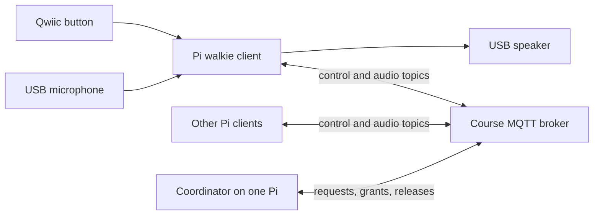
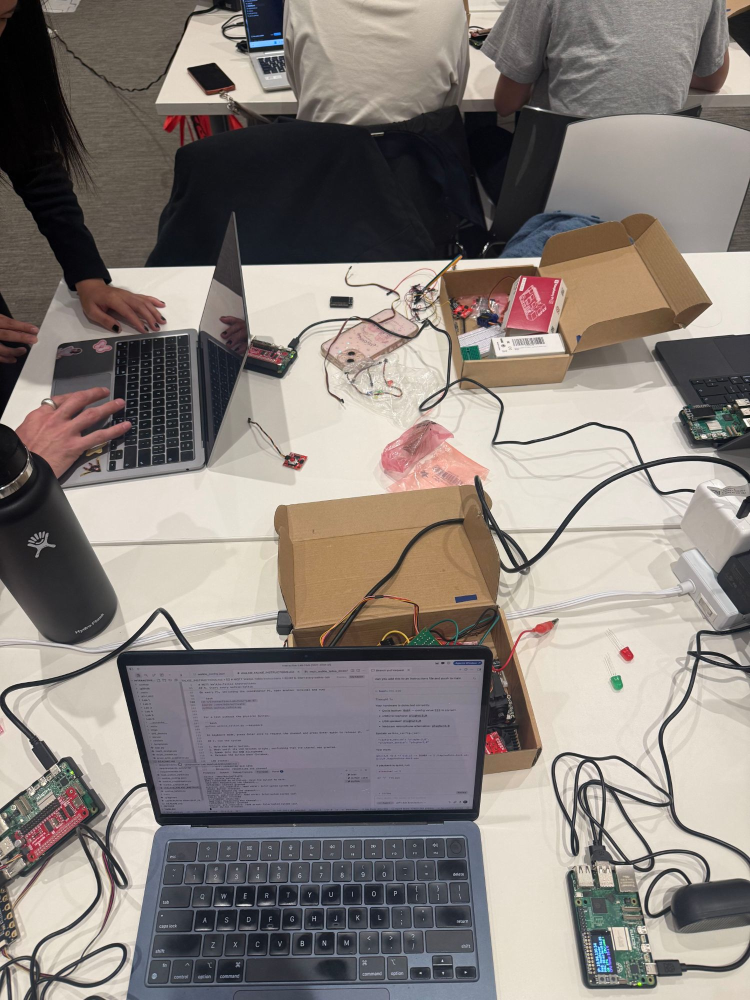
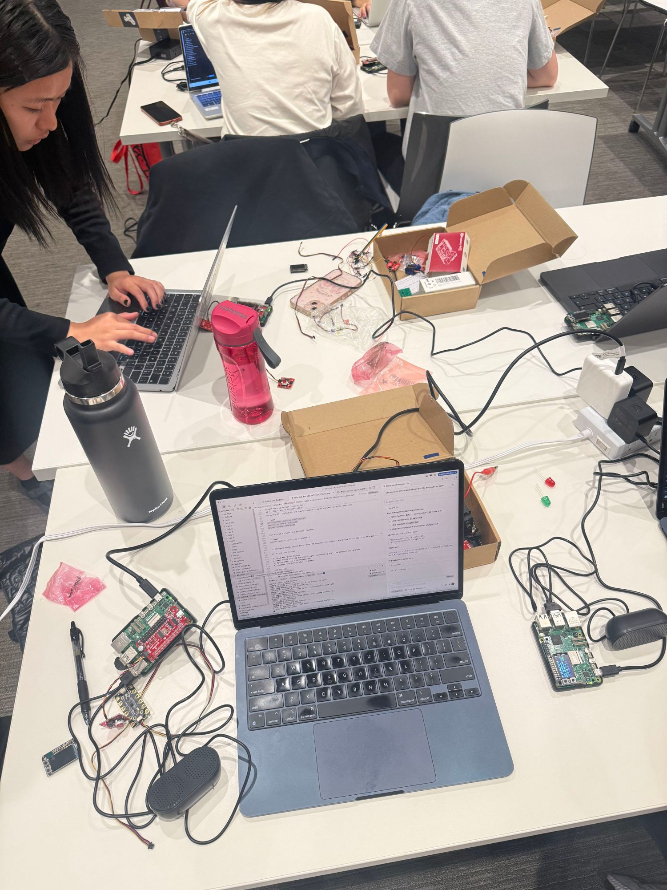

# Distributed Interaction: MQTT Walkie-Talkie

**Collaborators:** Elliot Waxman (ew558), Dhanu, as4422

Our project is a push-to-talk walkie-talkie made from three or more Raspberry Pis. Holding a Qwiic button requests the shared speaking channel. Once it is granted, audio from that Pi's USB microphone is broadcast through the course MQTT broker and played by the speakers on the other Pis. Releasing the button ends the transmission. A coordinator prevents multiple people from speaking at once.

See [WALKIE_TALKIE_INSTRUCTIONS.md](WALKIE_TALKIE_INSTRUCTIONS.md) for the team setup and operating guide.

---

## Five ideas for messaging between devices

1. **Directed office intercom** — use the capacitive sensor to pick which of the other Pis you want to contact, for quietly reaching a nearby colleague in an office without getting up or being too loud.
2. **Whisper down the lane** — each Pi can receive comms from one person and pass comms to one other person, turning the classic telephone game into a networked chain.
3. **Riddle scavenger hunt** — teammates must collectively solve sensor-based tasks to unlock answers to riddles, a Pi-based cooperative scavenger hunt.
4. **Collaborative collage** — the messages from multiple Pis combine into a computer-generated visual collage.
5. **Collaborative song** — the messages from multiple Pis combine into a computer-generated piece of music.

---

## Project description

Each participant has a Raspberry Pi, Qwiic button, USB microphone, and speaker. The interaction follows the familiar walkie-talkie model: hold the button, wait for the bright LED that confirms the channel is yours, speak, and release the button. Other devices play the live audio. If someone else already has the channel, the LED remains dim and the terminal identifies the active speaker.

The Qwiic button is each Pi's sensor input. Its press and release events travel through MQTT, satisfying the distributed sensor requirement. The same broker carries low-bandwidth audio so the Pis can communicate even when they are on different networks.

## Architecture



One Pi runs both its normal walkie client and the coordinator in separate processes. The coordinator grants the floor to the first requester for at most 30 seconds. It publishes an idle state after a release, timeout, or speaker disconnect. Audio is 16 kHz, mono, signed 16-bit PCM divided into 40 ms packets. Receivers reject duplicate, out-of-order, and stale packets and use a bounded jitter queue so latency cannot grow without limit. A rapid double-click on the coordinator Pi toggles a retained team-wide voice-obfuscation mode; when enabled, every sender applies ring modulation before its audio reaches MQTT.

## MQTT topics

Change `team_id` in `walkie_config.json` to a short, unique team name. All messages then live under `IDD/<team>/walkie/`:

- `control/request`: button presses requesting permission to speak
- `control/grant`: retained description of the current speaker and stream
- `control/release`: button releases that return the channel
- `control/deny/<device>`: busy response sent to one device
- `control/coordinator`: retained coordinator availability and heartbeat
- `presence/<device>`: retained online/offline status, including an MQTT last will
- `audio/<device>`: non-retained binary PCM packets at QoS 0

JSON control messages use QoS 1 because they must arrive. Audio uses QoS 0 because a late retransmission is worse than losing one short sound packet.

## Hardware

Each station needs:

- Raspberry Pi 5 with network access
- SparkFun Qwiic Button at the default I2C address `0x6F`
- USB microphone
- USB speaker or USB audio adapter with a speaker
- A suitable Pi 5 power supply

Connect the Qwiic button while the Pi is powered off. After booting, verify that it appears:

```bash
i2cdetect -y 1
arecord -l
aplay -l
```

If the USB devices are not selected by default, put their ALSA names, such as `plughw:2,0`, in `capture_device` and `playback_device` in `walkie_config.json`.

Our team's build and multi-Pi setup during the lab — each station has a Pi, a Qwiic button, a USB microphone, and a speaker:





## Installation

On every Pi:

```bash
cd ~/Interactive-Lab-Hub/"Lab 6"
python3 -m venv .venv
source .venv/bin/activate
sudo apt-get install -y alsa-utils
pip install -r requirements-pi.txt
```

Edit `walkie_config.json` so every Pi has the same `team_id`. Leave `device_id` empty to use each Pi's hostname automatically, or give every Pi a unique name.

First verify local audio before using the network:

```bash
arecord -D default -d 3 -f S16_LE -r 16000 -c 1 /tmp/walkie-test.wav
aplay -D default /tmp/walkie-test.wav
```

## Running the system

On one designated Pi, start the coordinator and leave it running:

```bash
cd ~/Interactive-Lab-Hub/"Lab 6"
source .venv/bin/activate
python walkie_coordinator.py
```

On every Pi, including the coordinator Pi, open another terminal and start the client:

```bash
cd ~/Interactive-Lab-Hub/"Lab 6"
source .venv/bin/activate
python walkie_talkie.py
```

For a desk test without the physical button, run `python walkie_talkie.py --keyboard`; each Enter press toggles between pressed and released.

Qwiic LED feedback:

- Off: connected and idle
- Blinking: requesting the channel
- Bright: speaking
- Dim: listening or channel busy
- Slow blinking: disconnected

Hold the button for at least 250 ms to speak. Quickly double-click the coordinator Pi's button while idle to toggle voice obfuscation for the whole team. Client terminals print the current mode. The robotic effect makes casual recognition harder but is not a guarantee of anonymity.

Stop each process with Ctrl-C. Run the automated protocol tests with:

```bash
python -m unittest -v test_walkie_talkie.py
```

## Failure handling and privacy

The floor has a fixed lease, so a crashed sender cannot hold the channel forever. MQTT last-will messages release a sender that disconnects cleanly from the broker, and the bounded playback queue drops delayed audio rather than playing it several seconds late.

The course MQTT broker is shared and uses an unencrypted connection. Team-specific topics prevent accidental overlap but do not make speech private: another broker user could subscribe to the audio topic. Voice obfuscation changes outgoing PCM before it reaches the broker, but it is only an experimental effect and cannot guarantee anonymity against voice analysis. Only test with consenting participants, do not transmit sensitive speech, and do not retain or record audio. A future production version should use an authenticated TLS broker or encrypt audio end to end.

## User testing

### Plan

Test with at least two people who are not on the team:

1. Give them the assembled devices without explaining the controls and ask what they think the button and LED will do.
2. Ask them to hold a short conversation from different networks.
3. Trigger two simultaneous button presses and observe whether the busy feedback is understandable.
4. Disconnect the active speaker and verify that another participant can speak after recovery.
5. Ask what surprised them, whether they knew when it was safe to speak, and what feedback they would change.

### Results

We tested with two classmates who were not on the team. We told them it was a walkie-talkie and that they needed to hold down the button to talk.

- **First reactions:** They picked up the hold-to-talk model from that one instruction, and were surprised to hear the echo effect on the returning audio.
- **What they would change:** Most of the feedback was about the physical form. They wanted to be able to pick the device up without the speaker hanging off the side on a wire, and for the button to be contained in the housing instead of dangling on its own wire. They also felt that, while the interaction was novel, it would have been more compelling if the two participants were in different rooms — with the two devices so close together, it was more practical to just talk directly than to use the walkie-talkies.

Video of classmates using the walkie-talkie: [clip 1](imgs/walkie-test-1.mp4) · [clip 2](imgs/walkie-test-2.mp4)

### Console evidence

Multi-device console evidence: [Elliot Pi voice-obfuscation test log](logs/elliot-pi-voice-obfuscation-test.txt). The log shows successful floor requests, speaking grants, listening to multiple teammates, and the coordinator switching voice obfuscation from off to on. The `arecord` interruption messages occur when recording is stopped after the push-to-talk button is released.

Additional console evidence: [Dhanu test log](logs/dhanu-voice-obfuscation-test.txt). The log shows listening to `elliot-pi` and `as4422-pi`, busy responses while another device held the channel, a granted channel, and voice obfuscation switching on.

## Reflection

The devices themselves functioned well. The main point of confusion was turn-taking: there was a little lack of clarity about exactly when it was okay to start speaking without talking over the other person.

The system ran with one **coordinator** Pi plus three other Pis communicating with each other. Only the coordinator could toggle "anonymity mode" — a double-press of its button turned everyone's voices into distorted echoes, so other participants could still hear the words but could not identify who was speaking. This centralization was also the system's main weakness: when the coordinator stopped, it stopped working for everyone. If the coordinator had to go offline for any reason, the whole team was cut off.

**Where computation happened:** sensing (button press/release) and audio capture happen locally on each Pi, while arbitration of the speaking floor and distribution of audio happen through the shared MQTT broker and the coordinator. Concentrating the turn-taking decision in one coordinator kept the rule simple and consistent, but made that coordinator a single point of failure — the clearest thing to improve in a more fault-tolerant version.
